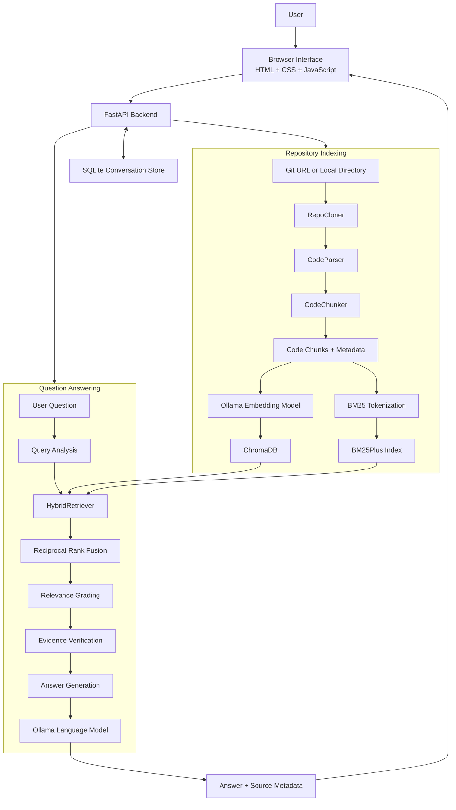
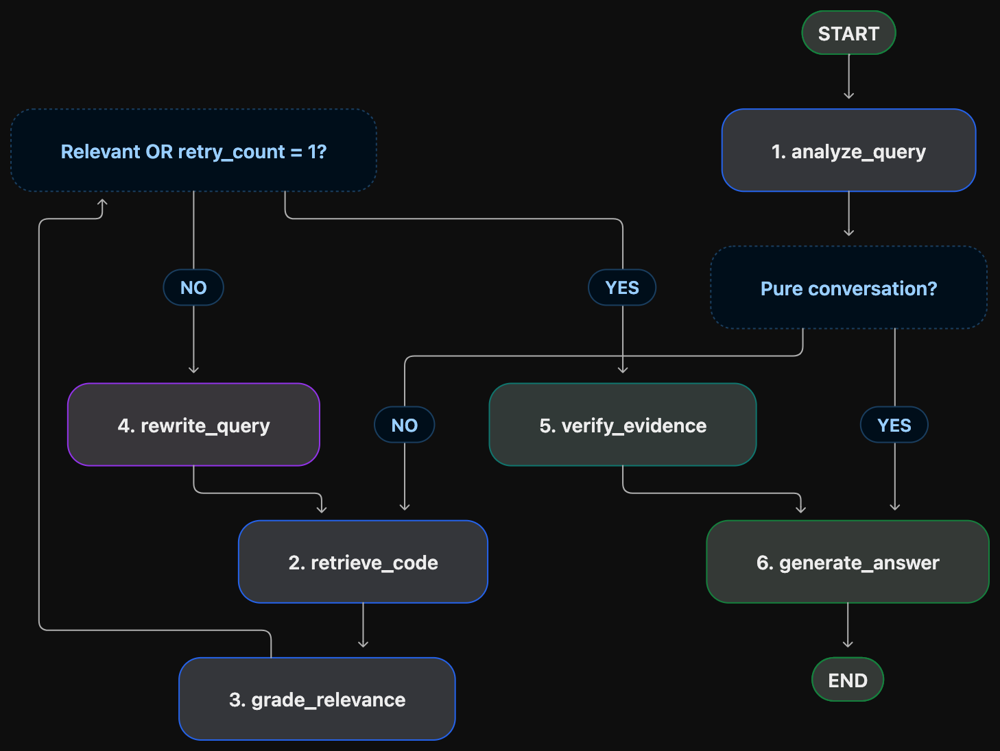
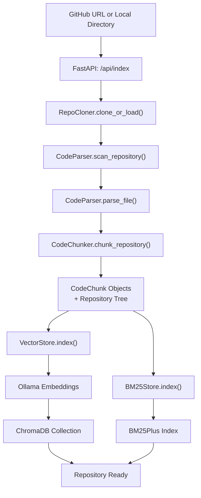
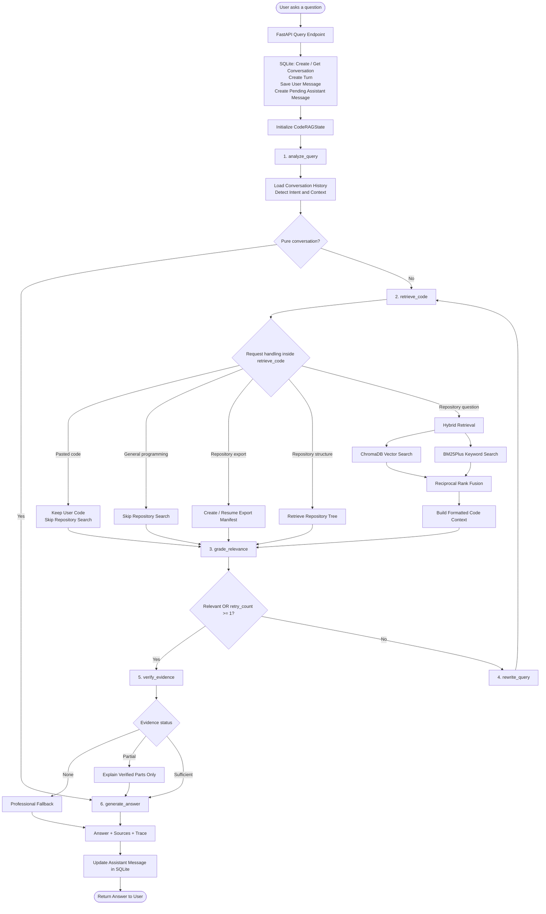
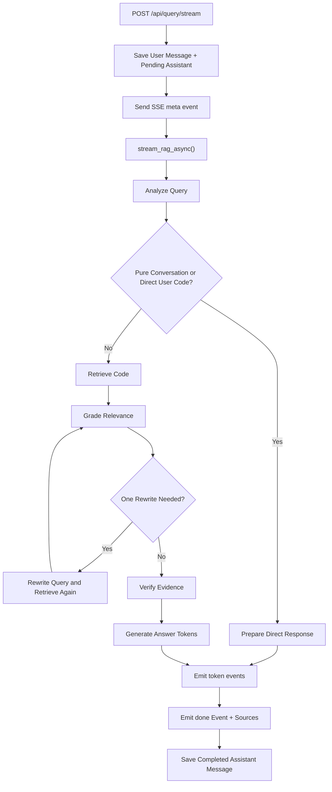
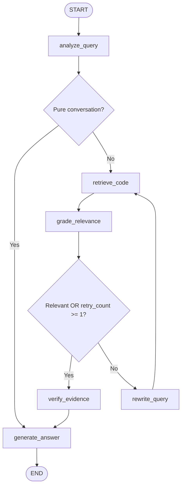
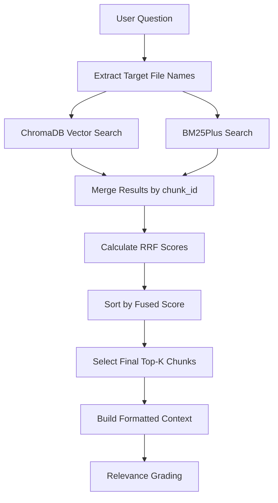
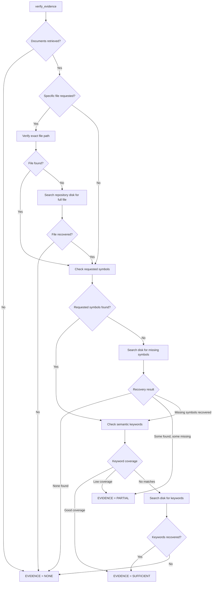
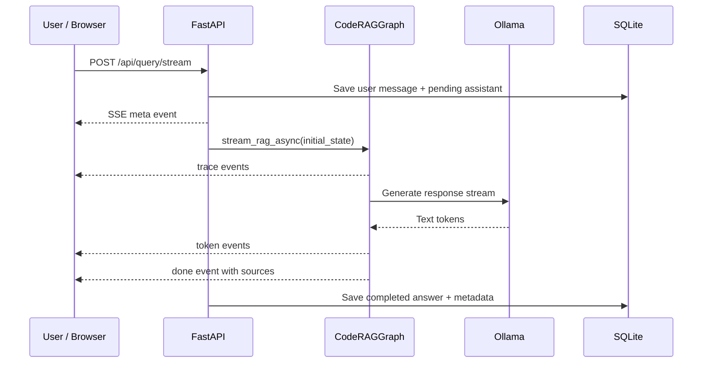

# GitHub Code RAG: An AST-Aware Hybrid Retrieval-Augmented Generation System Using LangGraph and OLMo

**Short name:** GitHub Code RAG with OLMo & LangGraph  
**Project:** GitHub Repositories Read RAG

A repository-aware codebase assistant that indexes GitHub repositories or local codebases, retrieves relevant source code, verifies repository evidence, and generates explanations with a locally hosted Ollama language model.

The system combines syntax-aware source parsing, metadata-rich code chunking, ChromaDB semantic search, BM25Plus lexical search, Reciprocal Rank Fusion (RRF), and a corrective LangGraph workflow. It also supports contextual conversations, complete-file retrieval, repository structure questions, repository export, persistent chat history, source references, and Server-Sent Events (SSE) streaming.

---

## Table of Contents

- [Overview](#overview)
- [Problem Statement](#problem-statement)
- [Objectives](#objectives)
- [Key Features](#key-features)
- [Technology Stack](#technology-stack)
- [System Architecture](#system-architecture)
- [Repository Indexing Pipeline](#repository-indexing-pipeline)
- [Complete User Question-to-Answer Flow](#complete-user-question-to-answer-flow)
- [LangGraph Workflow](#langgraph-workflow)
- [Hybrid Retrieval Strategy](#hybrid-retrieval-strategy)
- [Code Parsing and Chunking](#code-parsing-and-chunking)
- [Evidence Verification](#evidence-verification)
- [Answer Generation](#answer-generation)
- [Conversation Intelligence](#conversation-intelligence)
- [Complete Repository Export](#complete-repository-export)
- [Streaming Architecture](#streaming-architecture)
- [Persistence and Data Storage](#persistence-and-data-storage)
- [Project Structure](#project-structure)
- [Module-by-Module Documentation](#module-by-module-documentation)
- [REST API Reference](#rest-api-reference)
- [Installation and Setup](#installation-and-setup)
- [How to Use](#how-to-use)
- [Configuration](#configuration)
- [Testing](#testing)
- [Implementation Notes and Limitations](#implementation-notes-and-limitations)
- [Security and Data Handling](#security-and-data-handling)
- [Acknowledgements](#acknowledgements)
- [License](#license)

---

## Overview

Understanding a large software repository can require reading many files, tracing function calls, identifying classes, and following data through multiple modules. A conventional text-based search may find exact words but can miss code that is conceptually related to a question. A language model without repository evidence can also produce explanations that do not match the actual implementation.

GitHub Code RAG addresses these problems by preparing a searchable representation of a repository and using that representation as evidence when answering questions.

At a high level, the application:

1. Loads a remote Git repository or a local project directory.
2. Scans source files using configured extension, ignore, and file-size rules.
3. Parses supported source files into functions, classes, methods, notebook cells, or fallback sections.
4. Creates code chunks with file paths, symbol names, language, and line-range metadata.
5. Indexes each chunk in both ChromaDB and BM25Plus.
6. Retrieves relevant chunks using semantic and lexical search.
7. Combines retrieval rankings with Reciprocal Rank Fusion.
8. Grades retrieval relevance and can rewrite the query once.
9. Verifies requested files, symbols, and concepts against repository evidence.
10. Generates an answer through Ollama and returns source metadata where applicable.

The backend is built with Python and FastAPI. LangGraph coordinates the corrective RAG workflow, while Ollama provides local model inference and embedding generation. A browser-based frontend communicates with the backend through REST endpoints and an SSE streaming endpoint.

## Problem Statement

A repository-level coding assistant must do more than retrieve text that resembles a user's question. It should be able to:

- Locate exact files and programming symbols.
- Understand questions whose wording differs from the source-code identifiers.
- Preserve the relationship between a code fragment and its original file and line range.
- Distinguish repository-specific questions from general programming questions.
- Avoid presenting unverified functions, files, or implementation details as facts.
- Use prior conversation context to understand short follow-up questions.
- Deliver responses progressively when streaming is requested.

This project combines structural parsing, hybrid retrieval, evidence validation, and workflow orchestration to address these requirements.

## Objectives

- Build a searchable index from remote Git repositories and local codebases.
- Preserve useful source-code structure and location metadata.
- Support both semantic and exact-identifier retrieval.
- Improve retrieval quality by combining vector and lexical rankings.
- Validate repository evidence before producing repository-specific explanations.
- Keep unsupported repository claims out of the final answer through partial-evidence handling and a professional fallback.
- Support both standard JSON responses and progressive SSE responses.
- Maintain conversation history and resumable export progress.

## Key Features

| Feature | Description |
|---|---|
| Remote and local repository loading | Loads a Git repository or an existing local project directory. |
| Syntax-aware parsing | Uses Python AST parsing, declaration-pattern extraction for selected JavaScript/TypeScript constructs, notebook-cell parsing, and fallback sections. |
| Metadata-rich chunking | Stores file path, language, symbol name, symbol type, and source line range with each chunk. |
| Dense semantic retrieval | Uses Ollama embeddings and ChromaDB to retrieve conceptually related code. |
| Lexical retrieval | Uses BM25Plus for exact identifiers, filenames, and code terms. |
| Reciprocal Rank Fusion | Combines the ranked results from vector and lexical search. |
| Complete-file lookup | Can read a requested file directly from the repository working copy. |
| Repository structure queries | Generates a GitHub-style directory tree and can explain major modules. |
| Corrective retrieval | Grades relevance and performs one query-rewrite/retrieval retry when required. |
| Evidence verification | Checks requested files, symbols, and core terms; can recover missing evidence from disk. |
| Partial-evidence responses | Explains verified portions and identifies details that could not be confirmed. |
| Professional fallback | Avoids generating repository-specific claims when no usable evidence is found. |
| Direct code explanation | Explains code pasted directly into the chat without searching the repository. |
| Conversation intelligence | Handles greetings, mixed requests, contextual follow-ups, and confirmations. |
| Repository export | Exports eligible files in ordered batches and can resume an active export. |
| Real-time streaming | Sends progress and generated text through Server-Sent Events. |
| Persistent chat history | Stores conversations, turns, messages, source metadata, and export sessions in SQLite. |
| Local model execution | Uses an Ollama service for embeddings and text generation. |

## Technology Stack

| Technology | Role |
|---|---|
| Python | Main application language. |
| FastAPI | Backend REST API and SSE response delivery. |
| LangGraph | State-based query workflow and conditional routing. |
| Ollama | Local model and embedding service. |
| ChromaDB | Persistent vector storage and semantic retrieval. |
| BM25Plus | Lexical keyword and identifier retrieval. |
| Reciprocal Rank Fusion | Ranking method for combining retrieval results. |
| SQLite | Conversation, message, turn, and export-session persistence. |
| Python AST | Structural parsing of Python source code. |
| Pydantic | Request, response, settings, and data validation. |
| HTML, CSS, JavaScript | Browser-based user interface. |
| Prism (frontend) | Syntax highlighting in the browser interface. |

---

## System Architecture

The system has two major lifecycles:

1. **Repository indexing:** prepares the codebase and builds persistent retrieval indexes.
2. **Question answering:** receives a question, retrieves and verifies evidence, generates an answer, and returns it to the user.

### High-level architecture



### Existing project architecture diagram



Keep the image at `assets/pipeline_diagram.png` in the repository so GitHub can render it correctly.

### Main architectural layers

| Layer | Main components | Responsibility |
|---|---|---|
| Frontend | `index.html`, `styles.css`, `app.js` | Collects user input, calls the API, displays answers, and handles streaming events. |
| API | `main.py`, `schemas.py` | Validates requests, initializes services, manages endpoints, and returns results. |
| Core ingestion | `cloner.py`, `parser.py`, `chunker.py`, `models.py` | Loads repositories, parses source files, creates chunks, and defines data structures. |
| Storage | `vector_store.py`, `bm25_store.py`, `sqlite_store.py` | Stores searchable code indexes and persistent conversation data. |
| RAG | `retriever.py`, `state.py`, `graph.py`, `conversation.py`, `export_mode.py` | Retrieves evidence, manages workflow state, routes requests, validates evidence, and handles special query modes. |
| Model service | `ollama.py` | Communicates with local Ollama models for embeddings and response generation. |

---

## Repository Indexing Pipeline

Repository indexing is initiated through `POST /api/index`.

### Indexing flow



### Step 1 — Load the repository

**Module:** `src/code_rag/core/cloner.py`

`RepoCloner` is responsible for loading the source repository.

It supports:

- Remote Git repository URLs.
- Existing local repository directories.
- Shallow cloning for remote repositories.
- Reuse of previously loaded repository copies.
- Repository path tracking so a repository ID can be mapped to its local working directory.

The resulting repository working copy is used by the parser, retriever, full-file lookup, and disk-recovery operations.

### Step 2 — Scan and parse source files

**Module:** `src/code_rag/core/parser.py`

`CodeParser` scans the repository and applies the configured file-extension, ignore-directory, ignore-file, and maximum-file-size rules.

The parser selects an approach based on the file type and available parsing support.

| File category | Parsing approach |
|---|---|
| Python (`.py`) | Python AST traversal for supported functions, classes, and methods. |
| JavaScript / TypeScript | Declaration-pattern extraction for selected functions, classes, and constants. |
| Jupyter Notebook (`.ipynb`) | Notebook-cell parsing, including code and Markdown cells. |
| Short source files | File-level representation for short files according to the parser's configured threshold. |
| Other supported files | Section-based or sliding-window extraction where a language-specific parser is not used. |
| Parser fallback | Sliding-window sections when structural extraction does not produce usable symbols. |

The parser produces structured symbol information such as:

- Symbol name.
- Symbol type.
- Start line.
- End line.
- Source content.
- Optional docstring.
- Optional parent-class information.

**Important:** Having an extension in the chunker's language map does not mean every language has a full AST parser. Parsing depth depends on the implementation available for that language.

### Step 3 — Create code chunks

**Module:** `src/code_rag/core/chunker.py`

`CodeChunker.chunk_repository()` coordinates parsing and chunk construction.

Its responsibilities include:

1. Scanning the repository through `CodeParser`.
2. Creating a repository file-tree representation.
3. Creating a dedicated repository-structure chunk.
4. Converting parsed symbols or sections into `CodeChunk` objects.
5. Preserving file and symbol metadata.
6. Generating stable chunk identifiers from repository and source-location information.
7. Applying the configured maximum chunk-character limit to indexed content.

A code chunk carries fields such as:

| Field | Meaning |
|---|---|
| `chunk_id` | Identifier for the indexed chunk. |
| `repo_id` | Repository identifier. |
| `rel_path` | Relative source-file path. |
| `language` | Language label used for code formatting and retrieval metadata. |
| `symbol_name` | Function, class, method, cell, or section name. |
| `symbol_type` | Type of extracted symbol or section. |
| `start_line` | Starting source line. |
| `end_line` | Ending source line. |
| `code_content` | Source content stored in the chunk. |
| `formatted_content` | Metadata header combined with source content. |
| `docstring` | Available documentation string, if extracted. |

The formatted content provides retrieval systems with more context than a raw code fragment alone.

### Step 4 — Build the vector index

**Module:** `src/code_rag/storage/vector_store.py`

`VectorStore` manages ChromaDB collections.

During indexing, it:

1. Takes formatted chunk content.
2. Requests embeddings from `OllamaService`.
3. Creates or reuses the repository's ChromaDB collection.
4. Stores chunk IDs, embeddings, documents, and metadata.
5. Writes records in batches where configured.

During retrieval, it embeds the user's query and searches for semantically similar chunks.

### Step 5 — Build the lexical index

**Module:** `src/code_rag/storage/bm25_store.py`

`BM25Store` builds a BM25Plus index from formatted code chunks.

The lexical index is useful for exact names and identifiers such as:

```text
HybridRetriever
retrieve_code
search_disk_for_symbols
CodeRAGState
```

The code-aware tokenizer handles common identifier patterns to improve matching. The BM25 index and associated chunk information are stored persistently in the configured BM25 data directory.

### Step 6 — Repository becomes searchable

After indexing, the repository has two complementary search representations:

- **ChromaDB:** semantic similarity search.
- **BM25Plus:** lexical keyword and identifier search.

The query pipeline can now retrieve relevant chunks using the repository ID.

---

## Complete User Question-to-Answer Flow

This section follows a question from the browser to the final response. It describes both the request lifecycle and the processing decisions inside the RAG workflow.

### Request lifecycle

The API prepares the conversation before invoking the query pipeline.

1. The user submits a question from the frontend.
2. FastAPI receives the request and validates its fields.
3. The API uses the requested Ollama model when a model override is provided.
4. The API creates or retrieves the conversation.
5. The API creates a turn and saves the user message in SQLite.
6. The API creates a pending assistant message.
7. The API builds the initial `CodeRAGState`.
8. The request enters either the compiled LangGraph workflow or the asynchronous streaming orchestrator.
9. The pipeline generates an answer and source metadata.
10. The API saves the final assistant message and returns the response.

### Detailed question-processing diagram

The diagram below follows the **compiled LangGraph path** used by `POST /api/query`. Special request types are handled inside the existing nodes; they do not create additional nodes in the six-node graph.



### Streaming request path

`POST /api/query/stream` uses a separate asynchronous orchestration rather than invoking the compiled graph. Its path is:



The streaming path emits `meta`, `trace`, `token`, and `done` events. A cancellation is saved as `interrupted`; an exception is saved as `failed`.

### What happens at each stage?

| Stage | Component | Input | Output |
|---|---|---|---|
| Request reception | FastAPI | Repository ID and question | Validated request |
| Conversation setup | SQLiteStore | Conversation and turn identifiers | Saved user message and pending assistant message |
| State creation | `CodeRAGState` | Request information | Shared workflow state |
| Intent analysis | `analyze_query` | Question and history | Intent, entities, target files, and query type |
| Retrieval | `retrieve_code` | Repository-specific question | Retrieved chunks and context |
| Relevance grading | `grade_relevance` | Retrieved chunks and entities | Relevance decision |
| Query correction | `rewrite_query` | Original query and entities | Improved query for one retry |
| Evidence verification | `verify_evidence` | Retrieved evidence and requested details | `sufficient`, `partial`, or `none` |
| Answer generation | `generate_answer` | Question, evidence, and intent | Final answer and source metadata |
| Delivery | FastAPI | Generated answer | JSON response or SSE stream |
| Persistence | SQLiteStore | Final assistant response | Updated conversation history |

---

## LangGraph Workflow

**Main module:** `src/code_rag/rag/graph.py`

`CodeRAGGraph.build()` creates a LangGraph `StateGraph` using the shared `CodeRAGState`.

The compiled graph registers six nodes:

1. `analyze_query`
2. `retrieve_code`
3. `grade_relevance`
4. `rewrite_query`
5. `verify_evidence`
6. `generate_answer`

### Compiled graph



### Node 1 — `analyze_query`

**Purpose:** Understand the user's request before repository retrieval.

The node:

- Reads the current question and repository ID.
- Checks for an active repository-export session.
- Loads previous conversation messages when history is not already available in the state.
- Calls `ConversationHandler.detect_intent()`.
- Detects pure conversation, mixed intent, contextual follow-ups, and confirmations.
- Detects code pasted directly into the question.
- Detects complete repository export requests.
- Detects repository structure requests.
- Extracts target file names and query entities.
- Classifies the question as general programming or repository-specific.
- Assigns an intent such as `symbol_lookup`, `api_endpoint`, `line_by_line_explanation`, or `code_explanation`.

**Routing:**

- Pure conversation → `generate_answer`.
- Other request types → `retrieve_code`.

The special request types are handled inside the relevant nodes; they are not separate nodes in the compiled six-node graph.

### Node 2 — `retrieve_code`

**Purpose:** Obtain the source material required by the request.

The node has different paths depending on the request:

| Request type | Retrieval behavior |
|---|---|
| Pure conversation | Skips repository retrieval. |
| Repository export | Creates or resumes an export manifest and session. |
| User-pasted code | Skips repository search because the code is already supplied. |
| General programming | Skips repository-specific code retrieval. |
| Repository structure | Uses the repository-tree retrieval path. |
| Normal repository question | Calls `HybridRetriever.retrieve()` and builds context. |

For a normal repository query, the node returns information such as:

- `retrieved_docs`
- `context_str`
- `trace_steps`

### Node 3 — `grade_relevance`

**Purpose:** Determine whether the retrieved documents are relevant enough to proceed.

For ordinary repository questions, the grader checks:

- Whether any documents were retrieved.
- Whether extracted entities or symbols appear in the retrieved text.
- Whether the query has already been rewritten.

The core relevance condition is:

```python
is_relevant = len(docs) > 0 and (
    has_symbol_matches or retry >= 1
)
```

Special request types such as direct user code, general programming, repository export, and repository structure have pass-through handling.

**Routing:**

- Relevant, or `retry_count >= 1` → `verify_evidence`.
- Otherwise → `rewrite_query`.

### Node 4 — `rewrite_query`

**Purpose:** Improve the search query when the initial relevance check fails.

The node:

1. Reads extracted entities.
2. Increments `retry_count`.
3. Adds the extracted entities to the original question.
4. Adds search-oriented terms such as `definition`, `function`, `class`, and `implementation`.
5. Returns the rewritten question and updated trace steps.

The workflow then returns to `retrieve_code`.

The normal compiled workflow permits one rewrite retry because the initial retry count is zero and the routing condition sends the second retrieval result onward to evidence verification.

### Node 5 — `verify_evidence`

**Purpose:** Check whether the retrieved repository material supports the requested answer.

The evidence validator checks:

- Whether any documents were retrieved.
- Whether an explicitly requested file exists.
- Whether requested functions, classes, or methods are present.
- Whether important query terms appear in the retrieved code or file paths.
- Whether missing information can be recovered by searching the repository working copy.

The detailed checks are described in [Evidence Verification](#evidence-verification).

### Node 6 — `generate_answer`

**Purpose:** Produce the response using the appropriate answer path.

The node handles:

- Pure conversational responses.
- Professional fallback when evidence is `none`.
- Complete repository export.
- Direct user-pasted code explanations.
- Directory-tree output and optional architecture explanation.
- Complete-file output and optional explanation.
- General programming responses.
- Normal repository-grounded responses through Ollama.

For partial evidence, the prompt instructs the model to explain only verified implementation details and explicitly identify what could not be confirmed.

### Shared workflow state

**Module:** `src/code_rag/rag/state.py`

`CodeRAGState` is a TypedDict-based structure shared by the workflow nodes.

Important fields include:

| Field | Purpose |
|---|---|
| `question` | Current question, including a rewritten question when applicable. |
| `original_question` | User's original question. |
| `repo_id` | Repository being queried. |
| `conversation_id` | Conversation identifier. |
| `turn_id` | Turn identifier. |
| `query_intent` | Classified request intent. |
| `query_type` | Repository-specific or general-programming classification. |
| `extracted_entities` | Important identifiers and terms extracted from the question. |
| `target_files` | Explicitly requested file paths or names. |
| `retrieved_docs` | Retrieved code documents and metadata. |
| `context_str` | Formatted context supplied to the model. |
| `is_relevant` | Result of relevance grading. |
| `retry_count` | Number of query rewrites performed. |
| `evidence_status` | `sufficient`, `partial`, or `none`. |
| `user_code_snippet` | Code supplied directly by the user, when detected. |
| `export_info` | Parsed repository-export request details. |
| `export_session` | Current export progress and manifest. |
| `answer` | Generated answer. |
| `sources` | Source metadata associated with the answer. |
| `trace_steps` | Human-readable workflow trace. |

---

## Hybrid Retrieval Strategy

**Module:** `src/code_rag/rag/retriever.py`

`HybridRetriever.retrieve()` combines two complementary search methods:

1. Dense semantic retrieval from ChromaDB.
2. Lexical retrieval from BM25Plus.

The results are merged using Reciprocal Rank Fusion.

### 1. Dense retrieval — ChromaDB

Dense retrieval uses embeddings generated through Ollama.

It is useful when the user's wording differs from the names or comments used in the source code.

Example:

```text
Where does the application validate a user's login token?
```

The vector search can retrieve semantically related code even when the question does not contain the exact identifier used in the implementation.

### 2. Lexical retrieval — BM25Plus

BM25Plus is useful for exact code terms, identifiers, filenames, and programming symbols.

Example:

```text
Explain search_disk_for_symbols()
```

The code-aware tokenizer improves matching for common identifier formats.

### 3. Reciprocal Rank Fusion

The retriever combines the ranked results from the vector and BM25Plus stores.

The implementation uses the following ranking form:

\[
RRF(d) =
\sum_{r \in \text{retrieval systems}}
\frac{1}{k + \operatorname{rank}_r(d) + 1}
\]

Where:

- \(d\) is a candidate code chunk.
- \(k\) is the configured RRF constant.
- \(\operatorname{rank}_r(d)\) is the chunk's zero-based position in a retrieval result list.

A chunk that ranks highly in both retrieval systems receives a stronger combined score.

### Retrieval sequence



### Additional retrieval mechanisms

`HybridRetriever` also supports:

- **Full-file lookup:** searches the repository working copy for requested files and can return complete file content.
- **Repository tree retrieval:** generates a GitHub-style tree for structure and architecture questions.
- **Symbol recovery:** scans repository files for requested symbols when hybrid retrieval misses them.
- **Keyword recovery:** scans repository files for important query terms when retrieved chunks do not contain matching terms.
- **Context construction:** formats chunks with file path, language, line range, symbol name, symbol type, and source content.

### Context construction

`HybridRetriever.build_context()` prepares retrieved chunks for answer generation.

A context block includes information such as:

```text
File: src/example/service.py
Language: python
Symbol: ExampleService (class)
Lines: 10-85

<source code>
```

When the user explicitly requests a file and the retrieved chunks do not contain that file, the context builder adds a notice instructing the model not to attribute code from another file to the missing file.

---

## Evidence Verification

**Module:** `src/code_rag/rag/graph.py`  
**Main function:** `verify_evidence()`

Relevance grading and evidence verification are separate operations.

A result can pass the relevance grader but still fail evidence verification if the requested file or symbol cannot be confirmed.

### Evidence verification flow



### Verification stage 1 — Requested file

If the user names a file:

1. Compare the requested path with retrieved document paths.
2. If the file is absent from retrieved chunks, search the repository working copy.
3. If the full file is recovered, add it to the evidence context.
4. If the file cannot be found, return `evidence_status = none`.

This prevents the model from treating another file as the requested file.

### Verification stage 2 — Requested symbol

The verifier checks explicitly named functions, classes, methods, and other symbols against:

- Retrieved source content.
- Retrieved symbol metadata.

If a symbol is missing, the system calls the disk-recovery mechanism `search_disk_for_symbols()`.

The result can be:

- All requested symbols found.
- Some symbols found and some still missing.
- No requested symbols found.

When some requested symbols are found but others remain missing, the evidence can be classified as partial.

### Verification stage 3 — Semantic keyword coverage

The verifier extracts core terms from the original question and checks them against retrieved source content and file paths.

If no terms match, it attempts `search_disk_for_keywords()`.

The current implementation can classify coverage below 40% as partial when at least three core terms are present.

### Evidence outcomes

| Evidence status | Meaning | Response behavior |
|---|---|---|
| `sufficient` | The request passes the implemented evidence checks. | Generate an answer using the available verified context. |
| `partial` | Some requested information is verified, but other details remain unconfirmed. | Explain verified portions only and identify missing details. |
| `none` | No usable evidence was found, or a required file/symbol could not be verified. | Return the professional fallback response for repository-specific questions. |

**Important:** Evidence verification is heuristic. It checks paths, symbols, source text, and keyword coverage. It is a safeguard against unsupported answers, not a formal proof of program behavior.

---

## Answer Generation

**Module:** `src/code_rag/rag/graph.py`  
**Main function:** `generate_answer()`

After the workflow determines the evidence status and request type, the answer-generation stage selects the appropriate response path.

| Request / condition | Answer-generation behavior |
|---|---|
| Pure conversation | Returns the prepared conversational response. |
| Evidence is `none` | Returns the professional fallback response. |
| User-pasted code | Builds a dedicated line-by-line explanation prompt and sends it to Ollama. |
| Repository tree | Returns the tree and can generate a module/directory explanation. |
| Complete file | Outputs the complete retrieved file and can add a summary-oriented explanation. |
| Repository export | Generates the next ordered batch of eligible files. |
| General programming | Uses a general programming prompt without repository context. |
| Normal repository question | Builds a grounded prompt from the retrieved repository context. |
| Partial evidence | Instructs the model to explain verified details only and state what remains unverified. |

### Grounded answer generation

For normal repository-specific questions, the prompt includes:

- The original user question.
- The formatted repository context.
- Evidence status.
- Instructions not to invent files, functions, or citations.

The `OllamaService` sends the prompt to the selected local model.

### Source metadata

For repository-specific responses, source records can include:

- `file_path`
- `language`
- `symbol_name`
- `symbol_type`
- `start_line`
- `end_line`
- `score`
- `snippet`

These fields allow the frontend or API consumer to display the source files and relevant code locations associated with the answer.

General programming and pure conversational responses do not necessarily have repository citations.

---

## Conversation Intelligence

**Module:** `src/code_rag/rag/conversation.py`

`ConversationHandler` analyzes conversational intent before normal repository retrieval.

The implementation supports conversational handling in English, Bangla, and Banglish.

Recognized categories include:

- Greetings.
- Small talk.
- Gratitude.
- Acknowledgments.
- Apologies.
- Farewells.
- Identity questions.
- Capability questions.
- Mixed conversational and technical requests.

It also uses previous conversation messages to resolve contextual follow-ups and confirmations.

### Examples

| User message | Expected handling |
|---|---|
| `Hello` | Direct conversational response. |
| `Thanks` | Direct gratitude response. |
| `Hi, explain graph.py` | Preserve a conversational prefix and process the technical request. |
| `Explain more` | Resolve the follow-up using previous conversation context when available. |
| `Next` | Resume an active export session when one exists. |

### Conversation paths

- **Pure conversation:** bypasses repository retrieval.
- **Mixed intent:** separates the conversational prefix from the technical question.
- **Contextual follow-up:** resolves short questions using previous messages.
- **Context confirmation:** can resume a pending operation using the previous user request.

Conversation history is stored through `SQLiteStore` and can be loaded by the query workflow.

---

## Complete Repository Export

**Module:** `src/code_rag/rag/export_mode.py`

The export feature provides an ordered view of the repository tree and eligible file contents.

### Export process

1. Detect a complete-repository export request.
2. Scan the repository.
3. Apply export file and directory filters.
4. Build a GitHub-style directory tree.
5. Build an ordered file manifest.
6. Output the tree for a new export.
7. Export eligible file contents in batches.
8. Save export progress.
9. Resume from the next pending file when the user continues.

### Export batches

The current implementation uses a batch size of five files for larger exports. An export containing up to six files can be processed in one batch.

### Supported export categories

The export filter allows recognized source-code formats, README files, PDF files, and selected essential configuration files. A README-and-PDF-only export mode is also supported.

### Continuing an export

When an export session has pending files, the user can send a continuation message such as:

```text
Next
Continue
Next batch
Baki code dao
```

The system uses the saved export session to continue from the current file index.

### Sensitive-content handling

`sanitize_sensitive_content()` applies pattern-based redaction to recognized secret-like values in selected files. It includes patterns for values such as API keys, passwords, tokens, secrets, client secrets, and database URLs.

This is targeted redaction, not a complete secrets scanner. Exported content should be reviewed before it is shared publicly.

---

## Streaming Architecture

The project supports standard response generation and streaming response generation.

### Standard query

The `POST /api/query` endpoint invokes the compiled LangGraph workflow returned by `CodeRAGGraph.build()`.

The endpoint waits for the workflow result, converts source metadata into response models, saves the assistant response in SQLite, and returns a JSON response.

### Streaming query

The `POST /api/query/stream` endpoint uses `CodeRAGGraph.stream_rag_async()` and returns Server-Sent Events.

The asynchronous method manually orchestrates the major processing stages so that progress and generated text can be emitted as events.

### SSE event types

| Event type | Purpose |
|---|---|
| `meta` | Sends the conversation ID and turn ID at the beginning of the stream. |
| `trace` | Reports the current processing step. |
| `token` | Sends a portion of the generated answer. |
| `done` | Signals successful completion and includes sources and trace information. |
| `error` | Reports a streaming failure. |

### Streaming lifecycle



The API accumulates streamed tokens and updates the assistant message when the stream completes.

If the client cancels the stream, the assistant message can be marked `interrupted`. If an exception occurs during streaming, the message is marked `failed`.

### Important implementation distinction

The project has three workflow execution methods:

1. `build()` — creates the compiled LangGraph workflow.
2. `stream_rag()` — synchronous generator that manually orchestrates the stages.
3. `stream_rag_async()` — asynchronous generator used by the streaming API.

The streaming endpoint does **not** call the compiled graph's streaming API. It uses the separate asynchronous orchestration.

When changing query behavior, keep all three paths aligned. Otherwise, standard, synchronous-streaming, and asynchronous-streaming requests may behave differently.

---

## Persistence and Data Storage

The application uses separate storage systems for repository search and conversation history.

| Storage | Responsibility |
|---|---|
| ChromaDB | Persistent dense vector collections for indexed repositories. |
| BM25 index files | Serialized BM25Plus indexes and associated chunk metadata. |
| Repository working copies | Local copies of remote repositories or registered local repositories. |
| `repo_paths.json` | Maps repository IDs to local repository paths. |
| `chat_history.db` | Stores conversations, turns, messages, and export sessions. |

### SQLite data model

`SQLiteStore` manages the main conversation-related tables:

- `conversations`
- `turns`
- `messages`
- `export_sessions`

The SQLite implementation uses foreign-key support, WAL journal mode, a busy timeout, and indexes for common conversation, turn, and export-session lookups.

### Assistant-message lifecycle

For a standard or streaming query, the API creates a pending assistant message before processing.

After successful generation, it updates the message with:

- Answer content.
- Source metadata.
- Query intent.
- Model name.
- Completion status.

Streaming cancellation and errors use separate statuses so that incomplete answers are not represented as completed responses.

---

## Project Structure

The following structure represents the application source and the main runtime data locations. Generated database files and cloned repository contents are created while the application runs.

```text
GitHub-Repositories-Read-RAG/
├── _reference/
│   ├── folder_structure.txt
│   └── project_overview.md
│
├── assets/
│   └── pipeline_diagram.png
│
├── data/
│   ├── bm25_indices/
│   ├── chroma_db/
│   ├── repos/
│   ├── chat_history.db
│   ├── chat_history.db-shm
│   ├── chat_history.db-wal
│   └── repo_paths.json
│
├── src/
│   └── code_rag/
│       ├── api/
│       │   ├── __init__.py
│       │   ├── main.py
│       │   └── schemas.py
│       │
│       ├── core/
│       │   ├── __init__.py
│       │   ├── cloner.py
│       │   ├── parser.py
│       │   ├── chunker.py
│       │   └── models.py
│       │
│       ├── rag/
│       │   ├── __init__.py
│       │   ├── conversation.py
│       │   ├── export_mode.py
│       │   ├── graph.py
│       │   ├── retriever.py
│       │   └── state.py
│       │
│       ├── services/
│       │   ├── __init__.py
│       │   └── ollama.py
│       │
│       ├── static/
│       │   ├── app.js
│       │   ├── index.html
│       │   └── styles.css
│       │
│       ├── storage/
│       │   ├── __init__.py
│       │   ├── bm25_store.py
│       │   ├── sqlite_store.py
│       │   └── vector_store.py
│       │
│       ├── __init__.py
│       └── config.py
│
├── tests/
│   ├── test_evidence_validation_fallback.py
│   ├── test_natural_conversation_intelligence.py
│   ├── test_repository_code_export_mode.py
│   └── test_sqlite_chat_history.py
│
├── LICENSE
├── README.md
├── requirements.txt
└── run.py
```

### Runtime data

The `data/` directory contains generated application data:

- `chroma_db/`: persistent ChromaDB data.
- `bm25_indices/`: serialized BM25Plus indexes.
- `repos/`: cloned or registered repository working copies.
- `chat_history.db`: conversation database.
- `repo_paths.json`: repository ID-to-path mapping.

These are runtime data locations, not source-code modules.

---

## Module-by-Module Documentation

### API layer

#### `src/code_rag/api/main.py`

The FastAPI application entry module.

Responsibilities:

- Initialize the Ollama service, cloner, parser, chunker, stores, retriever, and RAG graph.
- Expose health and model endpoints.
- Accept repository indexing requests.
- List and delete indexed repositories.
- Accept standard and streaming questions.
- Manage conversation history endpoints.
- Serve the frontend static files.
- Save and update assistant messages.

#### `src/code_rag/api/schemas.py`

Defines Pydantic request and response models.

The API schema layer is responsible for validating incoming requests and structuring outgoing responses. Models include repository-indexing requests and responses, query requests, source citations, query responses, and repository-list/delete responses.

### Core layer

#### `src/code_rag/core/cloner.py`

Loads remote or local repositories and manages repository working copies and repository path resolution.

#### `src/code_rag/core/parser.py`

Scans supported source files and extracts symbols or sections using the parsing strategies available for each file type.

#### `src/code_rag/core/chunker.py`

Coordinates repository scanning and parsing, generates the repository tree, creates metadata-rich code chunks, and applies the configured chunk-size limit.

#### `src/code_rag/core/models.py`

Defines the structured data models used to represent extracted code symbols and indexed code chunks.

### Storage layer

#### `src/code_rag/storage/vector_store.py`

Manages ChromaDB collections, vector indexing, semantic search, repository listing, and vector-collection deletion.

#### `src/code_rag/storage/bm25_store.py`

Builds and searches repository-specific BM25Plus indexes and manages their serialized data.

#### `src/code_rag/storage/sqlite_store.py`

Manages persistent conversations, turns, user and assistant messages, source metadata, and export sessions.

### RAG layer

#### `src/code_rag/rag/retriever.py`

Performs hybrid retrieval, merges vector and lexical rankings through RRF, retrieves complete files where requested, performs disk-based symbol and keyword recovery, and builds model context.

#### `src/code_rag/rag/state.py`

Defines the `CodeRAGState` TypedDict shared between workflow stages.

#### `src/code_rag/rag/graph.py`

Implements the six LangGraph nodes, conditional routing, relevance grading, query rewriting, evidence validation, answer generation, repository export orchestration, and synchronous/asynchronous streaming methods.

#### `src/code_rag/rag/conversation.py`

Detects conversational intent, mixed requests, contextual follow-ups, and confirmations.

#### `src/code_rag/rag/export_mode.py`

Handles export-intent detection, eligible-file filtering, directory-tree and file-manifest creation, export batching, and selected sensitive-content redaction.

### Model service

#### `src/code_rag/services/ollama.py`

Connects the application to Ollama, manages model selection, generates embeddings, and produces standard or streamed language-model responses.

### Frontend

#### `src/code_rag/static/index.html`

Defines the browser application's structure.

#### `src/code_rag/static/styles.css`

Defines the frontend's visual layout and styling.

#### `src/code_rag/static/app.js`

Handles browser interactions, API requests, response rendering, streaming events, and syntax highlighting.

### Root-level files

| File | Responsibility |
|---|---|
| `config.py` | Central application settings. |
| `requirements.txt` | Python dependency list. |
| `run.py` | Application launcher. |
| `README.md` | Main project documentation. |
| `LICENSE` | Project license. |

---

## REST API Reference

The API is implemented in `src/code_rag/api/main.py`. The interactive API documentation is available from FastAPI at `/docs` while the application is running.

### Health and model endpoints

| Method | Endpoint | Description |
|---|---|---|
| `GET` | `/api/health` | Returns application health and active model information. |
| `GET` | `/api/models` | Lists available Ollama models and the active model. |

### Repository endpoints

| Method | Endpoint | Description |
|---|---|---|
| `POST` | `/api/index` | Loads and indexes a remote or local repository. |
| `GET` | `/api/repos` | Lists indexed repository IDs. |
| `DELETE` | `/api/repos/{repo_id}` | Deletes the repository's searchable data and local working copy where supported. |

### Query endpoints

| Method | Endpoint | Description |
|---|---|---|
| `POST` | `/api/query` | Runs the compiled LangGraph workflow and returns a JSON response. |
| `POST` | `/api/query/stream` | Streams progress and generated answer content through SSE. |

### Conversation endpoints

| Method | Endpoint | Description |
|---|---|---|
| `GET` | `/api/conversations` | Lists conversations. |
| `GET` | `/api/conversations/{conversation_id}` | Retrieves a conversation and its messages. |
| `GET` | `/api/conversations/{conversation_id}/messages` | Retrieves messages for a conversation. |
| `PATCH` | `/api/conversations/{conversation_id}` | Renames a conversation. |
| `DELETE` | `/api/conversations/{conversation_id}` | Deletes a conversation and its turns. |
| `DELETE` | `/api/conversations/{conversation_id}/turns/{turn_id}` | Deletes a turn and its associated messages. |

### Index a repository

```bash
curl -X POST "http://localhost:8000/api/index" \
  -H "Content-Type: application/json" \
  -d '{
    "repo_source": "https://github.com/pallets/flask",
    "force_reindex": false
  }'
```

For a local repository, provide its local directory path as `repo_source`.

### Ask a repository question

```bash
curl -X POST "http://localhost:8000/api/query" \
  -H "Content-Type: application/json" \
  -d '{
    "repo_id": "flask",
    "question": "Where is the application initialized?"
  }'
```

The query request uses the repository ID and question. Optional request values can select a model or associate the request with an existing conversation and turn, as supported by the active API schema.

### Stream a response

```bash
curl -N -X POST "http://localhost:8000/api/query/stream" \
  -H "Content-Type: application/json" \
  -d '{
    "repo_id": "flask",
    "question": "Explain the request handling flow."
  }'
```

### Query response information

A standard query response contains information such as:

- Repository ID.
- Original question.
- Query intent.
- Generated answer.
- Source citations.
- Workflow trace steps.
- Conversation and turn identifiers when returned by the active API response schema.

A source citation can contain the file path, language, symbol name, symbol type, line range, retrieval score, and source snippet.

---

## Installation and Setup

### Prerequisites

- Python 3.9 or newer.
- Git installed and available from the command line.
- Ollama installed and running.
- The language and embedding models configured for the application.
- Access to the repository source, either as a remote Git URL or a local directory.

### 1. Clone the project

```bash
git clone https://github.com/ashikhasanredoy/Github-repositories-read-RAG.git
cd Github-repositories-read-RAG
```

### 2. Create a virtual environment

**macOS / Linux**

```bash
python3 -m venv .venv
source .venv/bin/activate
```

**Windows PowerShell**

```powershell
python -m venv .venv
.venv\Scripts\Activate.ps1
```

### 3. Install Python dependencies

```bash
python -m pip install --upgrade pip
pip install -r requirements.txt
```

### 4. Start Ollama and prepare the models

Make sure the Ollama service is running.

The following commands are examples. Use the exact model names configured in `src/code_rag/config.py` for your environment.

```bash
ollama pull nomic-embed-text
ollama pull llama3.2:latest
```

If your configuration selects an OLMo model or another Ollama-compatible model, pull that configured model instead.

### 5. Start the application

```bash
python run.py
```

Open the web interface:

```text
http://localhost:8000
```

Open the interactive API documentation:

```text
http://localhost:8000/docs
```

---

## How to Use

### 1. Index a repository

1. Start the application.
2. Open the web interface.
3. Enter a GitHub repository URL or local repository directory.
4. Start repository indexing.
5. Wait for indexing to finish.
6. Select the indexed repository when asking questions.

### 2. Ask questions about the codebase

**Find a symbol**

```text
Where is HybridRetriever defined?
```

**Understand a function**

```text
Explain retrieve_code() and describe its execution flow.
```

**Understand an API route**

```text
Trace the request flow from POST /api/query to answer generation.
```

**Retrieve a complete file**

```text
Give me the complete source code of graph.py.
```

**Explore repository structure**

```text
Show the complete repository structure.
```

**Ask a general programming question**

```text
What is the difference between breadth-first search and depth-first search?
```

**Explain pasted code line by line**

````text
Explain this code line by line:

```python
def calculate_total(items):
    total = 0
    for item in items:
        total += item.price
    return total
```
````

**Export the repository**

```text
Show the folder structure first, then provide the eligible source files in batches.
```

To continue an active export:

```text
Next
```

### 3. Continue a conversation

Follow-up questions can use previous conversation context.

Examples:

```text
Explain that function in more detail.
Show me the caller of this method.
Continue.
```

The conversation handler attempts to resolve contextual follow-ups using saved conversation history.

---

## Configuration

Application settings are centralized in:

```text
src/code_rag/config.py
```

Review this file before changing model names, data directories, file filters, or retrieval behavior.

The configuration includes settings for areas such as:

- Ollama base URL.
- Preferred language model and embedding model names.
- Model generation parameters.
- Context-window and output-token limits.
- ChromaDB storage location.
- BM25 index location.
- Repository working-copy directory.
- SQLite application-data location.
- Supported file extensions.
- Ignored directories and file names.
- Maximum file size.
- Maximum indexed chunk length.
- Vector-search, BM25-search, and final retrieval limits.
- Reciprocal Rank Fusion configuration.

`OllamaService` also calculates a request-specific context size based on prompt length, bounded by the configured context limit.

---

## Testing

The project includes tests covering important application behavior:

| Test file | Area |
|---|---|
| `test_evidence_validation_fallback.py` | Evidence validation and fallback behavior. |
| `test_natural_conversation_intelligence.py` | Conversational intent and follow-up handling. |
| `test_repository_code_export_mode.py` | Repository export behavior. |
| `test_sqlite_chat_history.py` | SQLite conversation and message persistence. |

Run the test suite from the project root:

```bash
pytest
```

If pytest is not installed in the active environment:

```bash
pip install pytest
```

---

## Implementation Notes and Limitations

The following points describe important behavior and boundaries of the current implementation.

1. **Parsing is language-dependent.** Python uses AST parsing; selected JavaScript and TypeScript constructs use declaration-pattern extraction; other supported content may use sliding-window sections.
2. **An extension map is not the same as a full language parser.** A file can be recognized and indexed without having language-specific AST extraction.
3. **Indexed chunks can be length-limited.** The chunker applies a configured maximum chunk-character limit. Complete-file retrieval has a separate disk-based path.
4. **Relevance and evidence are separate checks.** Passing `grade_relevance` does not by itself prove that a requested file or symbol exists.
5. **The normal compiled workflow has one query-rewrite retry.** It proceeds to evidence verification when the query is relevant or the retry counter has reached one.
6. **Streaming and compiled execution are separate orchestrations.** Keep `build()`, `stream_rag()`, and `stream_rag_async()` aligned when changing workflow behavior.
7. **Full-file explanations are summary-oriented.** When a complete repository file is retrieved, the file is displayed and the follow-up explanation focuses on purpose, key components, and logic flow. The dedicated detailed line-by-line prompt is used for code pasted directly by the user.
8. **Secret redaction is pattern-based.** It is not a complete secrets scanner. Review exported files before publishing or sharing them.
9. **Evidence verification is heuristic.** It checks file paths, symbol text/metadata, and query-term matches; it should not be treated as a formal proof of program behavior.
10. **Model output depends on the selected local model.** Answer quality, latency, context capacity, and language support vary by model and hardware.
11. **Large repositories require more resources.** Repository size, number of chunks, embedding generation, and local model context requirements affect indexing time and query latency.

---

## Security and Data Handling

- Repository working copies and indexes are stored in the configured local data directories.
- Conversation history and export-session state are stored in SQLite.
- Ollama model inference is performed through the configured local Ollama service.
- Export redaction uses patterns and should not be treated as comprehensive secret detection.
- Review repository content and generated exports before sharing them.
- Do not expose local database files, repository caches, or sensitive configuration files in a public repository.

---

## Acknowledgements

- **Backend and RAG architecture:** [Ashik Hasan Redoy](https://github.com/ashikhasanredoy).
- **Frontend assistance:** The project's earlier documentation credits Claude (Anthropic) for assistance with frontend design and visual interactions.

## License

This project is distributed under the MIT License. See the [`LICENSE`](LICENSE) file for the full license text.

---

<p align="center">
  <strong>GitHub Code RAG with OLMo & LangGraph</strong><br>
  Understand your codebase through structural parsing, hybrid retrieval, evidence verification, and local AI.
</p>
